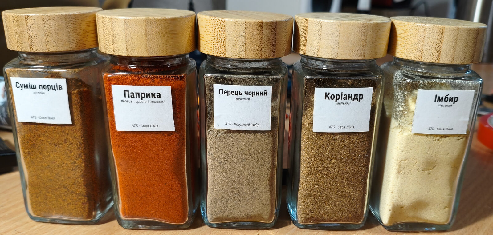
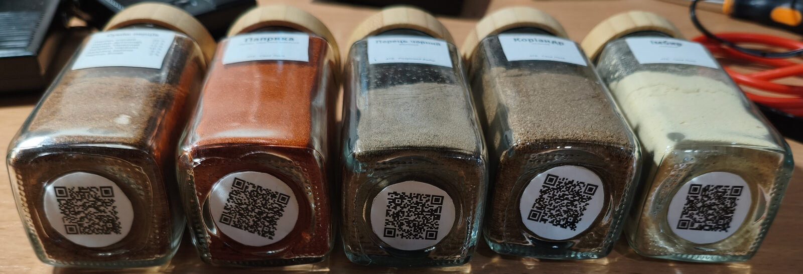
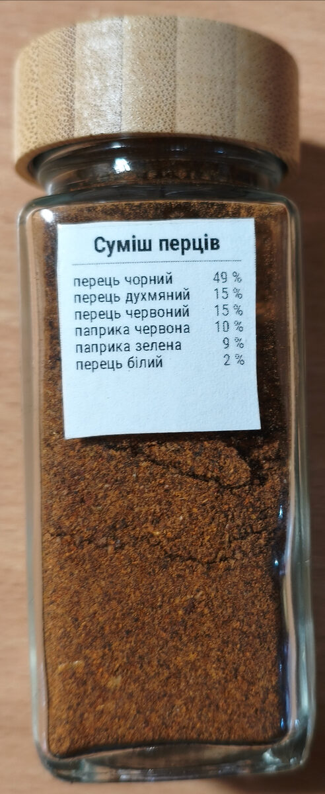

# Spice labels

**English** · [Українська](README.uk.md)

<p align="center"></p>

Consistent, printable labels for small square spice jars. You describe each spice in a TOML file; one command lays everything out on A4 as a duplex PDF with cut lines, QR codes and a tape guide on the reverse. Print, laminate with clear tape, back with double-sided tape, cut.

## What you get

Each entry in `spices.toml` turns into up to three labels:

| label  | size       | goes                       | content                          | made when            |
|--------|------------|----------------------------|----------------------------------|----------------------|
| front  | 28 × 22 mm | side of the jar, top third | name, subtitle, note, origin     | always               |
| back   | 28 × 30 mm | opposite side              | name and ratio table             | entry has `contents` |
| bottom | ⌀ 25 mm    | recess under the jar       | QR code, name printed behind it  | entry has `url`      |

<table>
<tr>
<td width="62%"></td>
<td width="38%"></td>
</tr>
</table>

The jar in the photos is a 30 mm square glass jar, 70 mm tall, with a 27 mm recess underneath. The front label is deliberately short so the contents stay visible. Every size is one number in the style block, so other jars are a one-line change.

## How it works

```
spices.toml     what to print — one [[spice]] block per jar
labels.typ      how it looks — geometry, fonts, sizes in the STYLE block; layout code below it
build.sh        one command: spices.toml → labels.pdf (and PNG previews)
atb_spices.md   worked example: six spices from a Ukrainian supermarket, with links
```

The engine is [Typst](https://typst.app). It reads the TOML natively, lays out in exact millimetres, measures text to auto-shrink long names, and draws QR codes with the [tiaoma](https://typst.app/universe/package/tiaoma) package. No Python, no LaTeX, no browser.

## Quick start

Requirements: Typst 0.14 or newer on your PATH, or Nix (the build script fetches Typst through `nix shell` when it is missing).

```sh
./build.sh                 # all labels → labels.pdf
./build.sh паприка імбир   # only entries whose name contains these words
PNG=1 ./build.sh           # also render preview/page-N.png
```

## Describing a spice

```toml
[[spice]]
name     = "Суміш перців"              # required; auto-shrinks, then wraps to two lines
subtitle = "мелена"                    # small italic line under the name
contents = { "перець чорний" = "49 %", "перець духмяний" = "15 %" }   # ratio table, order kept
source   = "АТБ · Своя Лінія"          # origin or shop
note     = "toast whole, grind fresh"  # one short line above the source
url      = "https://..."               # QR target — keep it short
copies   = 2                           # identical sets to print
```

Values in `contents` print as written: numbers for parts (`2`, `0.5`), strings for anything else (`"49 %"`, `"pinch"`, `""` for an ingredient list without amounts).

## Printing and assembly

1. Print `labels.pdf` double-sided, flip on the long edge, at 100 % / actual size. Never "fit to page". The 50 mm ruler in the footer must measure 50 mm.
2. Odd pages are sheet fronts. Each even page is the reverse of the sheet before it: the same outlines mirrored, plus the spice name behind every QR circle.
3. Laminate the front with clear tape, strip by strip, overlapping 1–2 mm, pressed flat with a card edge. Labels sit edge to edge, so some seams cross a label; burnish them.
4. Put double-sided tape on the reverse inside the printed outlines. Nothing is wasted on blank paper.
5. Cut from the front along the grey lines. Neighbours share a line, so one cut separates two labels. Cutting through both tapes seals paper, laminate and backing in one edge. Circles can be cut roughly: the recess hides the edge.

A label drawn with a red frame did not fit. Shorten the text or raise that label's height in the style block.

## Customising

Everything visual is in the `STYLE` block at the top of `labels.typ`:

- label sizes and the gap between labels (`gutter`, 0 by default; 3–4 mm if you want room for scissors)
- fonts: Roboto Condensed with DejaVu Sans as fallback, so Latin and Cyrillic both work; set `TYPST_FONT_PATHS` if Typst cannot see your system fonts
- title size range for the auto-fit, table and caption sizes
- QR size (16 mm; keep links short so the code stays coarse and scannable)

Printers shift the two sides of a duplex print by up to a millimetre. The reverse outlines are a tape guide, not a cutting guide: always cut from the front.
